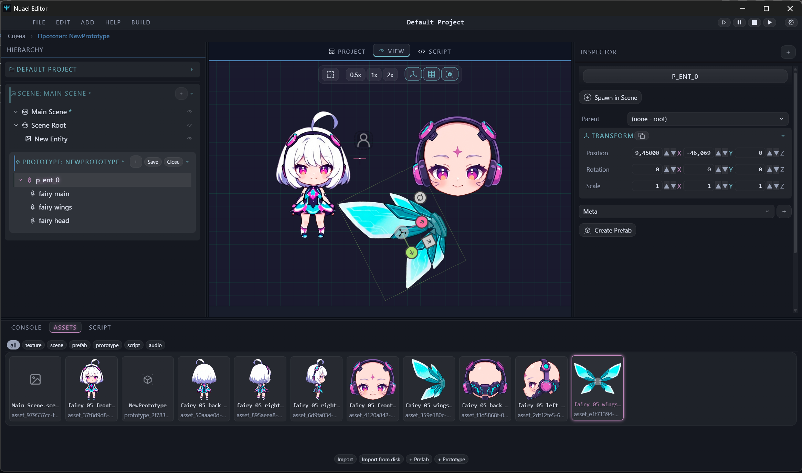

# Nuael Engine

**A game engine on the Deno + JavaScript stack — build your game into a single native exe with one button. No toolchains, no Python, no installers.**

> **Status: pre-alpha (v0.2.1-pre-alpha).** Things work, things may change. Feedback welcome.
>
> **0.2.1 — "it launches."** The window now falls back across browsers (Edge → Chrome → Firefox → any), the window runtime library is **bundled**, so the editor runs **offline with no first-run download**, and if the window can't open it says exactly why instead of going silent. Linux x64 builds are published too.

*To make dreams sing in your heart again.*

**Project website: [nuael.com](https://nuael.com)** · **itch.io: [tvortsa.itch.io/nuael](https://tvortsa.itch.io/nuael)** — downloads and news.

## Why Nuael

- **One-button builds** — from project to a single cross-platform exe. Download → open → press Build → ship.
- **Prototypes (stamps)** — design an entity once, stamp it across scenes, propagate changes or reset overrides. Spawn prototypes at runtime from scripts.
- **Built-in ML (zml)** — train tiny NPC brains (10–100k params) **locally, inside the engine, no Python**. NPC behavior is learned data: retrain with a different reward, get a different character.

## The editor (new in 0.2.0)

- **Context-coded workspace** — scene, prefab and prototype each carry their own color, header and actions. You always know exactly what you're editing.
- **Assets** — sprites, flipbooks, TexturePacker atlas import (both JSON flavors).
- **Transform gizmos** in every world — scene, prefab, prototype alike.
- **Honest undo/redo** — atomic, one operation per step, in editor and runtime alike.
- **Hotkeys with scopes**, process-pair architecture: the editor and the running game show the same change.

## The demos (see Releases)

| Demo | Shows |
|---|---|
| **Space Shooter** | Full game frame: splash → lobby → levels → win/lose. Atlases, animation, sound, project settings, one-button build. |
| **ZML NPC Arena** | Two NPCs, one technology: «trained to fight» vs «trained to never fight». The difference is a training command, not code. |

## Quick start

1. Grab `NuaelEditor` from **Releases**.
2. Open a demo project, press **Play**.
3. Press **Build** → get a single exe of the game.

## Troubleshooting

The editor runs quietly by default: the console window is hidden and everything is written to `logs/nuael.log` next to the executable. If something breaks:

1. Launch `NuaelEditor.exe --debug` — keeps the console visible, turns on debug logging and opens DevTools. `--help` lists every flag (`--browser edge|chrome|firefox|any`, `--log-level`). (Advanced users and bug reports only.)
2. Reproduce the issue.
3. Send us the console output and `logs/nuael.log`.

## Stack

Deno 2 · WebUI · PixiJS v8 · custom ECS · Process Pair architecture · zml (local RL micro-models)

## Roadmap

Pre-alpha → stabilization → **2D today, 3D next** (Orillusion 3D layer) → GUI framework spin-off.

## License & pricing

The editor and demos are distributed as **freeware binaries** (see LICENSE). Source code is not public at this stage.

**All pre-alpha and alpha versions are free.** Terms may be revised from the beta stage onward — but anything you've already downloaded stays free under the terms it shipped with. Your games are always yours.

---
*Made by Tvortsa. Pre-alpha — we're just getting started.*
